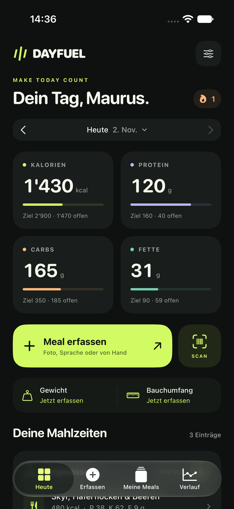
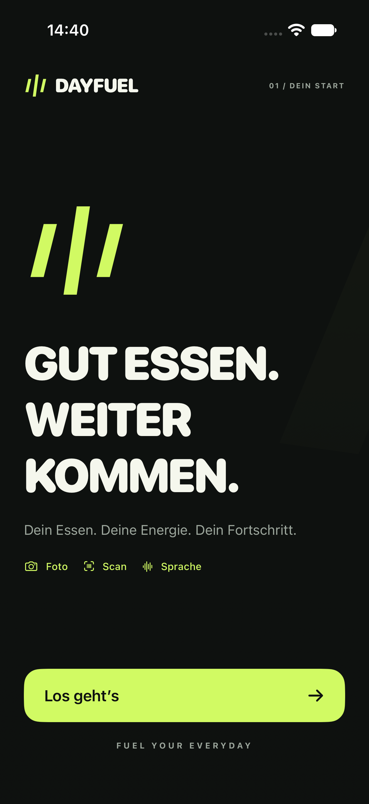
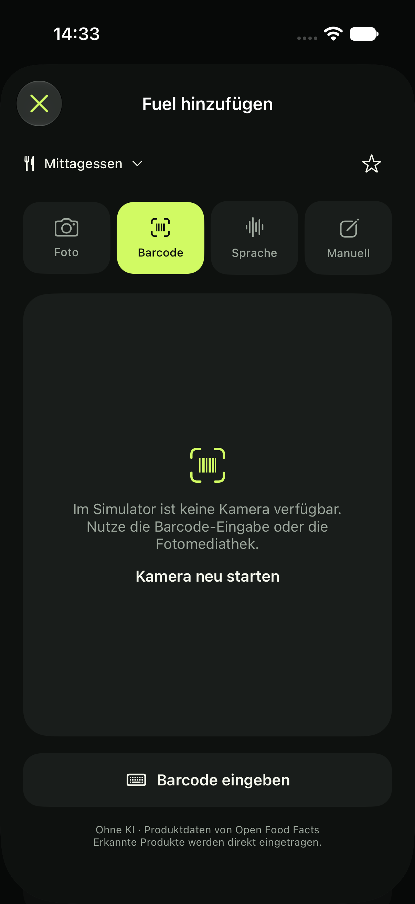
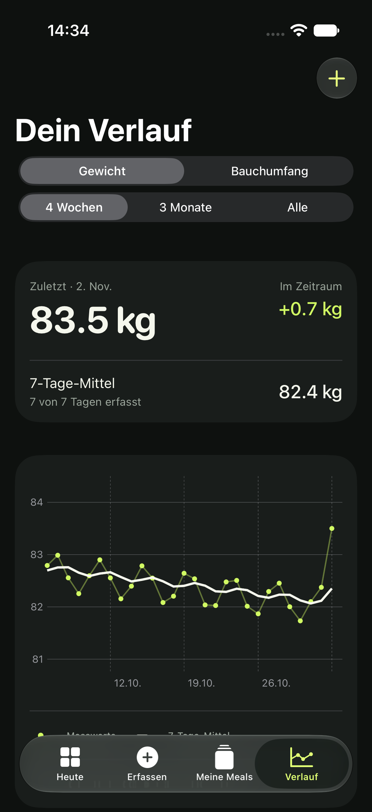

# DAYFUEL 2.0 — Rework vom 2. November 2026

## Ergebnis

Aurix wird zu DAYFUEL, vom Nutzer als sportlich-klare Markenrichtung gewählt. Neue Wortmarke, Vektorzeichen, App-Icon, Graphit-/Lime-Farbsystem sowie überarbeitete Screens für Einstieg, Tagesübersicht, Erfassung, eigene Meals, Verlauf und Einstellungen. Version 2.0, Build 3. Projekt- und Speicheridentität bleiben kompatibel.

## Scanner

Die ursprüngliche Kamera initialisierte Eingänge und Ausgänge in einer gemeinsamen Vorabprüfung, las Barcode-Typen vor Abschluss der Konfiguration und behandelte Unterbrechungen und Runtime-Fehler nicht. Der neue Ablauf fügt den Eingang vor den Ausgängen hinzu, bestimmt verfügbare Metadatentypen nach Abschluss der Konfiguration und meldet fehlende Scan-Unterstützung ausdrücklich. Autofokus, mittiger Fokuspunkt, Nahbereich (wenn unterstützt) und kontinuierliche Belichtung werden gesetzt. Ein sichtbarer Schalter bedient die Taschenlampe.

Session-Interruptions und Media-Services-Resets werden behandelt. Alle Session-Mutationen laufen auf einer seriellen Queue; Ergebnisse und Readiness werden auf dem Hauptthread nur an die noch gültige Erfassung zugestellt. Veraltete Fotoergebnisse werden verworfen. Beim Suchen stoppt die Kamera, Abbrechen/Retry starten den passenden Modus neu. Hintergrundwechsel beenden laufende Erfassung und Analyse. Alte Barcodes werden beim Moduswechsel gelöscht. Nur die ausdrücklich gewählte Aktion „Produkt von Hand speichern“ übergibt die Nummer an den manuellen Editor.

Ein gemeinsamer Core prüft GTIN-Prüfziffern und vereinheitlicht UPC-A, EAN-13 und mit Null aufgefüllte GTIN-14. UPC-E wird vor der Produktsuche expandiert. Die Kamera liest EAN-8, EAN-13, UPC-E und ITF-14, sofern vom Gerät unterstützt. Eine Zahleneingabe bleibt auch ohne Kamerazugriff verfügbar. Eigene Produkte werden über dieselbe Normalisierung gefunden.

Open-Food-Facts-Dekodierung ist separat testbar: deutsche/alternative Produktnamen, Zahlen mit Dezimalkomma, kcal/kJ sowie unterschiedliche Fehlersituationen. Fehlende Makros werden nicht auf null gesetzt. Produktcache und Portionsregeln bleiben erhalten.

Die Diagrammauswahl verwendet eine reine Tippgeste im Plotbereich. Vertikales Wischen scrollt dadurch weiterhin die Messhistorie, statt von der Diagrammauswahl abgefangen zu werden.

## Prüfung

Core-Tests: 30 Tests inklusive sechs neuer Scanner-/Produktdekoder-Tests, erfolgreich auf dem Mac. Unsigned Builds für iPhone und iOS-Simulator mit Xcode 27 Beta sind erfolgreich. Ein öffentlicher Live-Abruf (Nutella, 3017620422003) lieferte HTTP 200 und wurde durch den neuen Decoder/Portionsresolver verarbeitet. UI-Prüfung deckt Onboarding, Tagesübersicht, manuelles Erfassen, Wiederholen, Messwerte, Verlauf und einen gespeicherten UPC-A-Artikel ab, der über eine EAN-13-Eingabe gefunden wird. Die Barcode-Eingabe prüft auch, dass eine ungültige Nummer die Suche nicht freigibt. Debug-Vorschauen schreiben in einen eigenen Test-Unterordner.

Alle fünf UI-Tests sind auf dem iPhone-17-Pro-Simulator erfolgreich: drei Regressionstests (Scanner, Messwerte/Diagramm, Tagebuch/Meals) und zwei gezielte Onboarding-Tests nach dem scrollbar gemachten Einstieg. Die Diagrammprüfung schliesst jetzt Scrollen, Bearbeiten, erneutes Starten und Löschen ein.

Ein Simulator kann weder echten Kamerafokus noch physisches Barcode-Erkennen beweisen. Nach Installation auf dem iPhone noch prüfen: Produkt bei Tageslicht scannen, Taschenlampe, Kamera verweigern/erlauben, App während der Erfassung in den Hintergrund schicken und Foto/Barcode mehrfach wechseln. Ein echter OpenAI-Aufruf ist ohne privaten Schlüssel nicht Teil der Prüfung.

## Screenshots

Unveränderte Screenshots aus dem iPhone-17-Pro-Simulator mit lokalen Beispieldaten; der Scanner zeigt dort ausdrücklich die fehlende Hardware an.

| Heute | Einstieg | Scanner | Verlauf |
| --- | --- | --- | --- |
|  |  |  |  |

[Meine Meals](screenshots/13-meals.png) · [Einstellungen](screenshots/14-settings.png) · [Barcode-Eingabe](screenshots/12-barcode-entry.png)

## Referenzen

- [Apple: verfügbare Metadatentypen](https://developer.apple.com/documentation/avfoundation/avcapturemetadataoutput/availablemetadataobjecttypes)
- [Apple: Filterung nach Metadatentypen](https://developer.apple.com/documentation/avfoundation/avcapturemetadataoutput/metadataobjecttypes)
- [Apple: Kameraunterbrechungen](https://developer.apple.com/documentation/avfoundation/avcapturesession/wasinterruptednotification)
- [Apple: Laufzeitfehler](https://developer.apple.com/documentation/avfoundation/avcapturesession/runtimeerrornotification)
